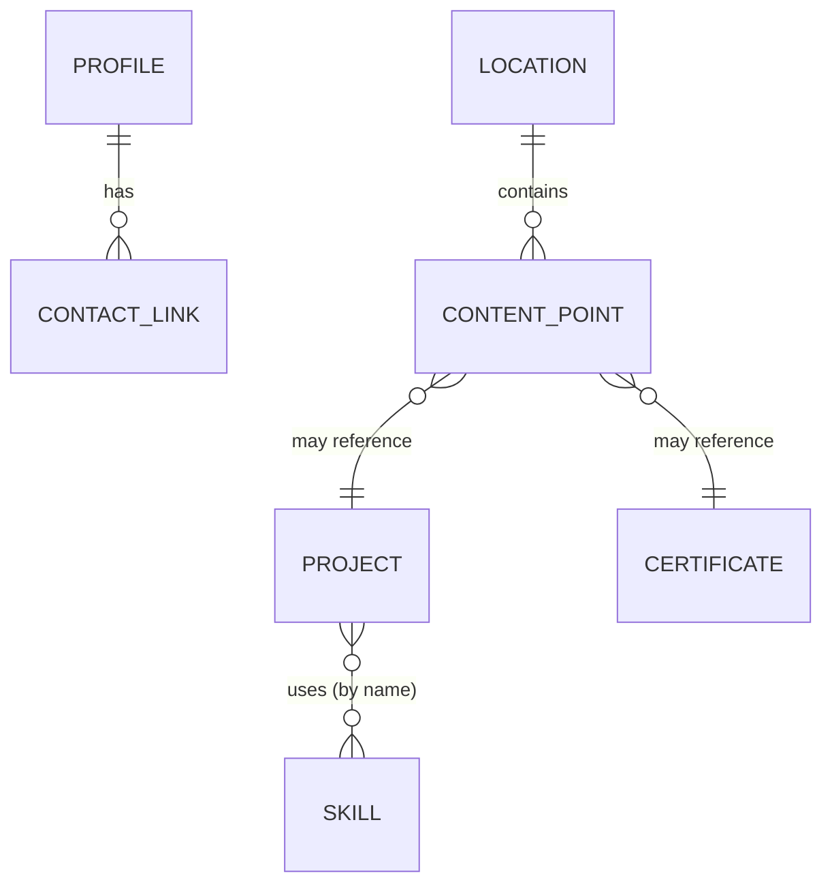

# Apeiron — System Specification (Phases 2–12)
Version 0.2 · 2026-11-10 · **APPROVED by Jefferson on 2026-11-10** · Companion to `portfolio-project-context.md` (vision, decisions, risks).
Legend: **[C]** confirmed by Jefferson · **[P]** proposed · **[TBD]** left empty on purpose · **[U]** unresolved
**Approval note:** every **[P]** item in this document was approved on 2026-11-10 and now counts as **[C]**. Only **[U]** and **[TBD]** items remain open.

This document is written so a Claude Code agent can build Apeiron without inventing behavior. If something is not specified here or in the context doc, the agent must ask, not guess.

---

## Phase 2 — Scope & Objectives

### v1 = Milestone M2 (first public version) [P]
| Priority | Item |
|---|---|
| Must | Loading screen with Launch button (unlocks audio) |
| Must | Earth + Home Station, The Forge, The Observatory, The Trophy Moon |
| Must | Walk on each planet as the astronaut (placeholder model allowed) |
| Must | Cinematic launch travel between locations |
| Must | Content points that open Vue panels (About, Work, Skills, Achievements, Activities, Contact) |
| Must | Quick-view 2D overlay + always-visible button |
| Must | Phone → 2D view with desktop notice |
| Must | Sound on by default + mute, quality setting |
| Must | Analytics |
| Must | Current VRM character removed (licensing) |
| Later (M3) | Pilotable set-route ship flight, landing/takeoff |
| Later (M4) | Final astronaut mascot, toon polish, 3 easter eggs |
| Later (M5) | Payroll project added, final performance pass |
| Won't | Backend, DB, CMS, accounts, multiplayer, AI chatbot, 3D on phones, custom domain, WebGPU, physics engine |

### Objectives (measurable) [P]
| ID | Objective | How it is checked |
|---|---|---|
| O1 | Projects + contact reachable in ≤ 2 clicks / ≤ 30 s | Manual test from first page load, desktop and phone |
| O2 | Interactive in ≤ 5 s, initial download ≤ 15 MB | Chrome DevTools, "Fast 4G" throttling |
| O3 | ≥ 50 fps average on a mid-range laptop (integrated GPU), quality "Medium" | stats.js during a full tour |
| O4 | Zero assets without a public-use license | Asset license table (§10) complete |
| O5 | No console errors during a full tour | DevTools console |

---

## Phase 3 — Users & Stakeholders

| Persona | Device | Goal | Path |
|---|---|---|---|
| **Recruiter** (primary) | Desktop or phone | Judge fit fast: projects, skills, contact | Quick-view button / phone 2D view |
| **Explorer** (dev, creative community) | Desktop | Enjoy the world, judge technical skill | Full adventure |
| **Phone visitor** | Phone/tablet | Basic info | 2D view only |
| **Owner** (Jefferson) | — | Update content without touching code | Edit data files in `sources/content/` |

No accounts, no roles, no permissions: every visitor sees the same public content. [P]

---

## Phase 4 — Requirements

### Functional requirements [P]
| ID | Requirement |
|---|---|
| FR-01 | Show a loading screen with progress; when ready, show a **Launch** button. |
| FR-02 | Clicking Launch starts audio (if not muted) and the intro (camera fly-in to the Home Station). |
| FR-03 | The visitor controls the astronaut with WASD/arrow keys, Shift to run, Space to jump, mouse drag to orbit the camera. |
| FR-04 | The astronaut walks on a spherical planet: gravity always points to the planet center. |
| FR-05 | Each location has content points; approaching within the interaction radius shows a prompt ("E — View projects"); pressing E or clicking opens the matching panel. |
| FR-06 | Each location has a launch pad; using it opens a destination picker; choosing one plays the cinematic travel and spawns the astronaut at the destination's landing point. |
| FR-07 | A HUD navigation menu lets the visitor jump to any location directly (same travel animation). |
| FR-08 | A "Skip the adventure" button is always visible on desktop and opens the quick-view overlay. |
| FR-09 | The quick-view overlay shows About, Projects, Skills, Achievements, Activities, Contact in one scrollable page. |
| FR-10 | The URL `/#quick` opens the site directly in quick-view (shareable link for recruiters). |
| FR-11 | On phones, the 3D world is never loaded; the 2D view is shown with a dismissible notice: "For the full space adventure, visit on a desktop." |
| FR-12 | Sound is on by default; a mute toggle is always visible; the choice is remembered. |
| FR-13 | Settings panel: quality (Low/Medium/High), sound, mute. Remembered between visits. |
| FR-14 | Empty data fields are hidden (see BR-07). |
| FR-15 | Project panel shows: title, summary, description, role, stack, key features, media, repo link, demo link, status. |
| FR-16 | Certificates open in a viewer with credential link. |
| FR-17 | Analytics events are sent (see BR-10). |
| FR-18 (M3) | Ship flight along set routes with limited steering. |
| FR-19 (M4) | 3 easter eggs; found ones remembered per browser. |

### Non-functional requirements [P]
| ID | Requirement |
|---|---|
| NFR-01 | Performance budget in §10 |
| NFR-02 | Works in latest Chrome, Edge, Firefox, Safari (desktop); WebGL 2 |
| NFR-03 | If WebGL is not available, show the 2D view automatically |
| NFR-04 | All panels keyboard-accessible; Esc closes the top panel; visible focus states |
| NFR-05 | Text contrast WCAG AA in all panels and the 2D view |
| NFR-06 | Respect `prefers-reduced-motion`: shorter travel animation, no camera shake |
| NFR-07 | Content is edited only in `sources/content/*.js`; no code changes needed for content |
| NFR-08 | All assets licensed for public use and listed in `CREDITS.md` |
| NFR-09 | Hosted on Vercel (free plan, `.vercel.app` address); every push to `main` deploys; every branch gets a preview URL |

---

## Phase 5 — Business Logic & Workflows

### App state machine [P]
```
BOOT
 ├─ isPhone || !webgl ─────────────► MOBILE_2D   (terminal; 3D never loads)
 ├─ URL #quick ────────────────────► QUICK_VIEW  (3D loads in background on desktop)
 └─ else ──────────────────────────► LOADING
LOADING ──(assets ready)──────────► READY        (Launch button visible)
READY ──(click Launch)────────────► INTRO        (fly-in, audio starts)
INTRO ──(intro done / skip)───────► ON_FOOT
ON_FOOT ──(E on content point)────► PANEL_OPEN   (movement paused)
PANEL_OPEN ──(Esc / close)────────► ON_FOOT
ON_FOOT ──(launch pad / HUD nav)──► TRAVELING    (input disabled)
TRAVELING ──(arrived)─────────────► ON_FOOT
any desktop state ──(Skip button)─► QUICK_VIEW   (3D paused, not destroyed)
QUICK_VIEW ──(close)──────────────► previous state (or READY if never launched)
M3 adds: ON_FOOT ──(enter ship)──► FLYING ──(land)──► ON_FOOT
```

### Business rules [P]
| ID | Rule |
|---|---|
| BR-01 **Phone detection** | Phone = `matchMedia('(pointer: coarse)')` is true AND `(hover: none)` is true. Tablets count as phones. A small desktop window still gets 3D. |
| BR-02 **Audio** | Audio never plays before the first click. Default = on. Mute state saved in localStorage key `apeiron.settings`. |
| BR-03 **Interaction** | A content point is "in range" within 3 world units of the astronaut. Only the nearest in-range point shows a prompt. |
| BR-04 **Movement lock** | Input is ignored while PANEL_OPEN, TRAVELING, QUICK_VIEW, or INTRO. |
| BR-05 **Travel** | Travel takes 4–6 s (1.5 s with reduced motion), cannot be interrupted, always ends at the destination landing point facing its main content point. |
| BR-06 **Falling / leaving** | The astronaut cannot leave a planet on foot; jumping returns to the surface by gravity. |
| BR-07 **Empty fields** | Empty string, empty array, or missing field = hidden. Never render "N/A", "TBD", blank buttons, or dead links. Project without media → themed placeholder image. Project without title or summary → not rendered. Resume button hidden while `resumeUrl` is empty. |
| BR-08 **Featured projects** | `featured: true` projects show large on The Forge and first in quick-view; others in an archive list. Order follows `order` field. |
| BR-09 **Settings** | Quality default: High if `devicePixelRatio ≤ 1.5` and WebGL max texture ≥ 8192, otherwise Medium. Saved in `apeiron.settings`. |
| BR-10 **Analytics events** | `launch`, `quickview_open` (source: button/url/mobile), `location_visit` (id), `project_open` (id), `contact_click` (type), `certificate_open` (id), `easter_egg_found` (id, M4). No personal data. |
| BR-11 **Easter eggs (M4)** | 3 eggs, content [TBD]. Found state saved in `apeiron.eggs`. A small counter (x/3) appears in the HUD after the first egg is found. |

### Main workflows
1. **Recruiter (desktop):** load → Skip button → quick-view → project → repo/demo link. ≤ 2 clicks.
2. **Recruiter (phone):** load → 2D view → scroll → Contact.
3. **Explorer:** Launch → intro → walk Home Station → launch pad → The Forge → open project → HUD nav → Observatory …
4. **Owner update:** edit `sources/content/projects.js` → commit → Vercel deploys.

---

## Phase 6 — UI/UX Plan

### Screens & overlays [P]
| ID | Screen | Contents |
|---|---|---|
| S1 | Loading | Apeiron logo, progress bar, Launch button, small "Skip to quick view" link |
| S2 | World HUD | Top-left: location name. Top-right: Skip the adventure, mute, settings. Bottom-center: interaction prompt. Bottom-left: controls hint (fades after 10 s). Left: location nav (collapsible). |
| S3 | Destination picker | Cards for the 4 locations with icon + one-line description |
| S4 | Panels | About, Project (Work), Skills, Achievements + certificate viewer, Activities, Contact. Reuse existing `PanelShell.vue` |
| S5 | Quick-view | One page: header (name, role, contact buttons) → Featured projects → Archive → Skills → Achievements → Activities → About → footer. Sticky "Back to the adventure" button (desktop only) |
| S6 | Mobile 2D | Same layout as S5 without the back button, plus the dismissible desktop notice at the top |
| S7 | Settings | Quality, sound, mute, reset |

### Visual direction [C/P]
- Cute low-poly, colorful, toon shading [C]. Palette: deep navy space, warm accent per planet (Forge orange, Observatory teal, Trophy Moon gold, Earth blue/green) [P].
- UI: rounded glass panels over the 3D scene, reuse existing `tokens.css` and update the colors [P].

### Controls [P]
WASD/arrows move · Shift run · Space jump · mouse drag rotate camera · scroll zoom · E interact · Esc close · M mute.

---

## Phase 7 — System Design (modules)

| Module | Responsibility | Status |
|---|---|---|
| `Game` (core) | Boot, main loop, state machine (§5), events to UI | Refactor existing |
| `State/Player` | Movement on sphere, jump, input → velocity | Rewrite |
| `State/Planets` | Planet definitions: center, radius, gravity, landing point, content points, launch pad | New |
| `State/Travel` | Travel requests, timing, arrival | Replaces `Teleporter.js` |
| `State/Controls` | Keyboard/mouse input | Keep, adjust |
| `View/Planet` | Planet mesh, props, content point markers | New |
| `View/Space` | Starfield, nebula background, sun | Reuse stars shader + new sky |
| `View/PlayerModel` | Astronaut model + animations | Adapt |
| `View/CameraThirdPerson` | Follow camera aligned to planet "up" | Adapt |
| `View/TravelCinematic` | Camera + ship path animation (GSAP) | New |
| `Audio` | Music + SFX, mute, unlock on Launch | New, small |
| `Analytics` | `track(event, data)` wrapper | New, small |
| `UI` (Vue) | HUD, panels, quick-view, mobile view, settings | Reuse + extend |
| `UIBridge` | Single event channel Game ↔ UI | Keep |
| `content/` | All text and links | Consolidate `about.js` + `projects.js` |

**Removed:** Chunks, Terrain(s), Grass, Water, Terrain workers, DayCycle, Sun (old), CameraFly (debug only — keep behind `#debug`).

---

## Phase 8 — Software Architecture

### Stack [C]
Three.js (WebGL 2) · Vue 3 · GSAP · Vite · GLSL · Vercel. No new frameworks. Added only if needed: `@gltf-transform/cli` (dev, asset compression). [P]

### Key technical decisions [P]
| Topic | Decision | Why |
|---|---|---|
| Physics | **No physics engine** [C — approved after discussion 2026-11-10]. Planets are perfect spheres; astronaut height = radius; props use simple sphere colliders. Revisit (Rapier + custom per-planet gravity) only if physical play such as kicking or pushing objects is added to scope. | Engines assume one global "down"; spherical gravity is custom math either way. Avoids ~1–2 MB WASM and a second world to sync |
| Gravity | `up = normalize(playerPos − planetCenter)`; move in the tangent plane; re-project to radius each frame | Standard small-planet technique |
| Camera | Third-person, its "up" follows the player's `up` (slerped for smoothness) | Prevents disorienting flips |
| Travel | Scripted GSAP timeline along a curve between planets; no free physics | Matches "set routes" decision |
| Content ↔ world | Planet config references content IDs (e.g., content point `project:onsite`); UI resolves IDs from `content/` | Content changes never touch 3D code |
| Game ↔ UI | `UIBridge` events only: `panel:open {type,id}`, `state:change`, `location:change`, `settings:change` | One channel, easy to debug |
| Phones | Check BR-01 **before** importing Three.js (dynamic `import()`), so phones never download 3D code | Saves the phone budget |
| Assets | glTF/GLB with meshopt compression, WebP textures, one character GLB with animations baked in | Small and fast; avoids shipping raw FBX files |
| Videos | Re-encode to ≤ 4 MB each (H.264, 720p), poster image, `preload="none"`, load on panel open | Biggest current weight problem |
| Analytics | Tool [U]: must support custom events on a free plan (check Vercel Web Analytics plan limits vs GoatCounter) | Need `project_open` tracking |
| Deploy | **Vercel only** [C]: production from `main`, preview deploy per branch, free `.vercel.app` address (project can be renamed, e.g. `apeiron`, if available); remove GitHub Pages workflow | Decision: Vercel only, no custom domain |

### Folder structure [P]
```
sources/
  index.js                 # boot: phone check → 2D or 3D
  content/                 # ALL editable content (owner edits only here)
    profile.js  projects.js  skills.js  achievements.js  activities.js  contact.js
  Game/
    Game.js  StateMachine.js  Audio.js  Analytics.js
    State/   Player.js  Planets.js  Travel.js  Controls.js  Viewport.js  Time.js
    View/    Renderer.js  Space.js  Planet.js  PlayerModel.js  Camera.js  TravelCinematic.js
             Materials/  (toon + stars shaders)
    config/  planets.js     # planet layout, content point positions, launch pads
    Debug/
  UI/
    App.vue  UIBridge.js
    components/  HUD/  panels/  QuickView/  MobileView/
    styles/tokens.css
public/
  models/  (astronaut.glb, planets/*.glb, props/*.glb)
  media/   (projects/*.mp4 + posters, certificates/*.webp)
  audio/
CREDITS.md  LICENSE  CLAUDE.md
```

---

## Phase 9 — Data Model (no database)

There is **no database**: content is static JS modules bundled at build time [P]. This section is the "ERD" for content.



| Entity | Fields (required **bold**) |
|---|---|
| Profile | **name**, **role**, bio[], location, school, year, program, avatar, currentlyLearning[], resumeUrl [TBD], experience[] {period, title, place, bullets[]} |
| ContactLink | **type** (email/github/linkedin/facebook), **url**, label |
| Project | **id**, **title**, **summary**, description, role, stack[], keyFeatures[], media {type, src, poster, alt}, repoUrl, demoUrl, status, featured (bool), order (int) |
| SkillGroup | **group**, **items[]** |
| Certificate | **id**, **title**, issuer, year, image, credentialId, credentialUrl |
| Activity | **id**, **title**, role, year, description, url |
| Location (config) | **id** (station/forge/observatory/trophy), **name**, center, radius, color, landingPoint, launchPad, contentPoints[] |
| ContentPoint (config) | **id**, **position** (lat/long on sphere), **opens** (panel type), refId (optional) |

**Initial content** = current `about.js` + `projects.js` data, merged, plus [TBD] entries for Sourcerer Crusade, Requisito, Payroll System (Payroll `featured: false`, hidden until title+summary exist per BR-07). Fix: 3D Portfolio links [TBD]; Onsite stack = Java, Swing, JSON (from `about.js`).

---

## Phase 10/11 — Consolidation & Validation

### Performance budget [P]
| Item | Budget |
|---|---|
| Initial JS (gzipped) | ≤ 400 KB (Three.js included) |
| Initial 3D assets | ≤ 8 MB |
| Each project video | ≤ 4 MB, loaded on demand |
| Draw calls | ≤ 150 per frame |
| Triangles on screen | ≤ 300k |
| Phone 2D page total | ≤ 2 MB excluding videos |

### Asset license table (must be complete before M2 launch) [P]
`CREDITS.md` lists every 3D model, texture, sound, and font: name, author, source URL, license (CC0 / CC-BY / own work). CC-BY requires credit in the site footer and quick-view.

### Consistency check (done)
- Every confirmed decision in the context doc maps to a requirement: phones → FR-11/BR-01; quick-view → FR-08–10; sound → FR-12/BR-02; empty fields → FR-14/BR-07; easter eggs → FR-19/BR-11; Vercel only → NFR-09/§8; Apeiron/Earth → §6 S1, planets config.
- No requirement needs a backend or database.
- Open risks: Mixamo animations must be baked into the character GLB, not shipped as raw FBX files [P]; analytics tool [U].

---

## Phase 12 — Development Readiness

### Milestone specs & acceptance criteria [P]
**M0 — Cleanup**
- [ ] Removed: Chunks, Terrain(s), Grass, Water, terrain workers, DayCycle, GitHub Pages workflow, `character.vrm`
- [ ] `sources/content/` created; data merged; no duplicate project data
- [ ] Videos re-encoded ≤ 4 MB + posters; `Idle.fbx` issue gone
- [ ] `LICENSE`, `CREDITS.md`, `CLAUDE.md` added
- [ ] Empty scene with starfield renders; UI panels still open from the HUD; build passes; deploys to Vercel

**M1 — Walkable planet**
- [ ] One planet; astronaut placeholder walks all around it (including the "bottom") without jitter or camera flips
- [ ] Run, jump, idle animations play correctly
- [ ] One content point: prompt appears within 3 units, E opens the Work panel, movement locked while open
- [ ] ≥ 50 fps on target laptop

**M2 — First public version**
- [ ] 4 locations with themes and props; Earth visible from the Station
- [ ] Launch pads + HUD nav travel (BR-05) work between all locations
- [ ] All panels reachable in-world; quick-view (FR-08–10) works; `/#quick` works
- [ ] Phone shows 2D view only (verify Three.js is not downloaded)
- [ ] Sound/mute/settings persist; analytics events received
- [ ] Objectives O1–O5 pass; `CREDITS.md` complete
- [ ] Jefferson's browser review approved → public on Vercel

**M3 — Flight:** enter ship at launch pad, fly a route corridor with limited steering, auto-land; replaces cinematic travel for desktop (cinematic kept for HUD nav and reduced motion).
**M4 — Polish:** final mascot, toon shading pass, SFX, 3 easter eggs (BR-11).
**M5 — Final:** Payroll added when ready, performance re-check, final deploy.

### `CLAUDE.md` (draft for the repo) [P]
```
# Apeiron — rules for coding agents
Read docs first: portfolio-project-context.md and apeiron-system-spec.md (copies in /docs).
- Stack is fixed: Three.js (WebGL2), Vue 3, GSAP, Vite. Do not add frameworks, physics engines, backends, or state libraries.
- Game code in sources/Game (State = logic, View = rendering). UI in sources/UI. Content ONLY in sources/content.
- Game ↔ UI communication only through UIBridge events.
- Never invent content. Empty fields stay empty and are hidden (BR-07).
- Never add assets without a public-use license; record each in CREDITS.md.
- Respect the performance budget (spec §10). Compress models (meshopt) and textures (WebP).
- Phones must never load Three.js (dynamic import after phone check).
- Hosting is Vercel only. Do not add other deploy targets.
- Work only on the current milestone's checklist. If something is unspecified, stop and ask.
- Run `npm run build` before declaring a task done.
```

### Ready-to-build checklist
- [x] Vision, goals, audience, scope
- [x] Requirements, business rules, state machine
- [x] UI plan, modules, architecture, content data model
- [x] Milestones with acceptance criteria, agent rules
- [x] Jefferson approves this spec (all [P] items) — 2026-11-10
- [x] Physics approach: no engine (approved 2026-11-10)
- [x] Hosting: Vercel only (confirmed)
- [ ] Analytics tool chosen [U] — resolve during M2
- [ ] Placeholder astronaut + CC0 asset pack chosen (first task of M0/M1)
